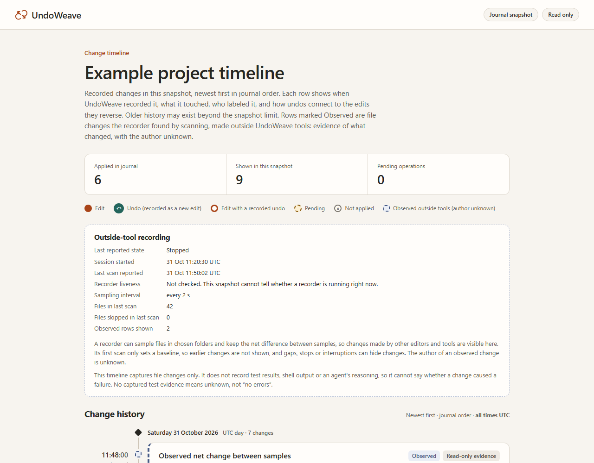

> **Upgrade from v0.1:** it has a confirmed repeated-line alignment bug that can restore the wrong text. Version 0.2 includes the conservative fix and regression tests. Stop old clients and review [migration instructions](docs/MIGRATION.md) before reusing history. Preserve independent backups.

<p align="center"></p>

<h1 align="center">UndoWeave</h1>
<p align="center"><strong>See what changed. Keep the evidence when the chat is gone.</strong></p>
<p align="center">A local change timeline and selective undo for coding work.</p>
<p align="center"><a href="#try-it">Try it</a> · <a href="docs/INSTALL.md">Connect your agent</a> · <a href="docs/AGENT_INSTRUCTIONS.md">Agent instructions</a> · <a href="docs/COMPARISON.md">Measured comparisons</a></p>
<p align="center"><a href="https://github.com/Jgolding1998/undoweave/actions/workflows/checks.yml"></a></p>

Agent A changes one line. You change another. Agent B changes a third. UndoWeave can reverse A's recorded edit while keeping your and B's separate changes. Overlapping or ambiguous edits produce a conflict, with no project file changed.

Optional project recording observes changes made with an agent's own editor or a human's editor. You can inspect saved diffs after restarting the agent, without asking it to remember. Recording starts only for the paths you explicitly select.

**Two kinds of evidence:** edits made through UndoWeave's tools support selective undo. Outside changes are observed net snapshots with unknown authors and timing limits. They are read-only evidence, not individually undoable agent actions. Nothing identifies a failure's cause automatically or replaces Git backups. Actor names on tool edits are caller-supplied labels.

First initialization creates a small, source-free `.undoweave-id` marker in the chosen project. Keep it and exclude it from version control. Existing v0.1 journals need [explicit reviewed adoption](docs/MIGRATION.md); the MCP never guesses their identity.

## Try it

Python 3.11+ and Git are required for this install command. No AI subscription, API key, or paid service is needed for the demo.

```sh
python -I -m pip install "undoweave[mcp] @ git+https://github.com/Jgolding1998/undoweave.git@v0.4.0"
undoweave demo
undoweave demo --recording
```

Both demos use disposable directories. The first checks selective undo and preservation of separate work. The recording demo captures an ordinary outside save, restarts the engine, and verifies the retained diff. Neither edits your project or calls a model. If your system requires an isolated Python environment, see the [installation guide](docs/INSTALL.md).

From a source checkout:

```sh
python -I -m venv .venv
# Activate .venv, then:
python -I -m pip install ".[mcp]"
python -I -m undoweave demo
```

There is no PyPI release yet. Use the versioned Git install above or install this checkout. The name was checked against GitHub repository search, PyPI and npm before creation; those checks do not establish global name exclusivity.

## Use it with an agent

Open a terminal in your project folder and run:

```sh
undoweave setup --client claude      # or --client codex; leave it out for JSON
```

Setup prints what it chose before anything else:

```text
Project: /home/me/code/shop (git_marker: .git)
Recording paths: manage.py, shop_core, tests
Connection name: undoweave-shop-537c26f5
Tools can read/edit supported files inside this project; only the listed paths are observed.
Nothing has been connected or recorded yet.
```

followed by what to apply for your client. Setup reads only names and file
types plus the project's `.gitignore`, never file contents, and changes
nothing. Once connected, the tools can read and edit supported files anywhere
in the project; the recording paths only decide which outside saves are
observed. Review both, apply the printed connection, then restart or reconnect
your client.

- Started in a subfolder, setup uses the nearest project file (such as
  `package.json` or `pyproject.toml`) or Git folder. In a monorepo that can be one package. To choose,
  run `undoweave --root /absolute/project setup`.
- To record only certain paths, add `--watch src --watch tests`.
- Each project gets its own connection name, so connecting a second project
  leaves the first one in place. `--name` picks a name yourself.
- If setup cannot find a project or code paths, it stops and asks you to
  choose. It never picks your home folder, a drive or a broad folder.

`setup` is new in 0.4.0. The 0.3 release has only `config`, which still
works for explicit paths: `undoweave --root /absolute/project config --watch src`
(without `--watch` for tool edits only).

An agent can do this for you. Optionally add the
[UndoWeave skill](docs/INSTALL.md#4-optional-add-the-undoweave-skill) and ask:

> Set up UndoWeave for this project. Show me the folders it picked before
> connecting.

The skill is instructions only. The server, once connected, provides the tools.

Without the skill, ask the agent to read the `safe_editing` prompt or the
`undoweave://instructions` resource, or give it these instructions:

> Use UndoWeave's read_file and write_file tools for edits I want recorded. Use a fixed actor name. Read first and pass the returned expected hash. To undo an edit, show me preview_undo's diff and get my approval before apply_undo. If it conflicts, stop and explain. Do not bypass a refusal with another editor.

The root is fixed at startup. Tools cannot choose another project or run commands. See [full agent instructions](docs/AGENT_INSTRUCTIONS.md) and [Claude Code setup](docs/INSTALL.md).

| Tool | Purpose |
| --- | --- |
| `read_file` | Read selected UTF-8 text and its expected hash |
| `write_file` | Record one whole-file replacement, creation, or explicit deletion |
| `replace_text` | Record one exact unique text replacement using the full-file hash |
| `list_changes` | List source-free operation summaries |
| `inspect_change` | Read the saved evidence and bounded diff for one change |
| `preview_undo` | Review an inverse and obtain a short-lived token |
| `apply_undo` | Apply that reviewed inverse if the file and recorded history are still current |
| `workspace_status` | Show configuration, limits, and journal counts |

For a small change, `read_file` can return metadata or selected lines and
`replace_text` can send only the exact old/new text. The hash always covers the
whole file; this reduces MCP payloads, not the local file hashing work. Ambiguous
or overlapping duplicate matches are refused.

## What did the agent change?

Ask your agent to read `workspace_status`, `list_changes`, and `inspect_change` for the relevant IDs. It can explain the actual saved differences, distinguish tool edits from unknown-author observations, and tell you where recording was incomplete. That evidence survives a new conversation or a different MCP client using the same project journal.

You can also record selected paths in a separate terminal:

```sh
undoweave --root /absolute/project watch src tests
```

Keep it running while you work; Ctrl+C stops it. Use one recorder per journal, either the foreground command or one MCP server with `--watch`. It never runs your project or test commands. [Recording guide and limits](docs/RECORDING.md).

Two work sessions can leave identical final files but have different earlier changes. A fresh model given only the final files cannot uniquely recover that missing history. A model with the recorded evidence can inspect it. In a 20-case synthetic regression, all 29 stable transitions were retained after restarting, distinguishing nine pairs with identical starting and final files. One deliberately unobservable pair stayed unknown. [Reproduce the comparison](benchmarks/recording/README.md). The journal still cannot establish who made an outside change, capture every fast save, prove that tests passed, or prove which change caused a failure.

## What happens when changes overlap?

UndoWeave refuses. It does not insert conflict markers, guess which copy of repeated text you intended, or offer a force switch. A refusal can also mean the change exceeds its review or complexity limits. A fresh preview is required if the selected file changes after review.

Separate changes need unchanged lines that occur exactly once in each snapshot
to separate them. Adjacent edits, repeated braces and blank lines can therefore
require manual review. This deliberate refusal replaces v0.1's alignment,
which could accept the wrong repeated-text undo; use the current release.

Each successful undo is recorded as another edit. Previewing and undoing that inverse provides redo. Recovery is one file at a time; this release has no atomic multi-file transaction or automatic undo-all-by-agent.
It tracks text content, not complete filesystem metadata. Recreated files need their permissions reviewed; custom ACLs and extended attributes are not restored.

## See your change timeline



Times follow the continuous line, grouped by UTC day. An undo links to the
edit it reverses; pending and unapplied operations have distinct markers and
labels. The image uses synthetic data from the actual renderer.

```sh
python -I -m undoweave --root /absolute/project history --format html > timeline.html
```

Open the resulting file in your browser. The standalone, read-only timeline
shows the newest 50 recorded changes, with labels, actors, paths, times and undo
relationships. It contains no source snapshots, diffs, hashes or preview tokens;
paths and labels can still be private. Review before sharing. Use `--limit 200`
for a larger snapshot. It does not scan the project or apply undos.

The MCP also exposes `undoweave://timeline` as an HTML resource. Client rendering
support varies; the CLI export works independently. Try the
[synthetic timeline example](docs/examples/timeline.html).

## Privacy and safety

- No server port, telemetry, shell execution, model calls, or automatic upload. The MCP transport is stdio.
- The local journal stores **plaintext before/after source** outside the project by default. It is not encrypted. Keep it private, include it in your retention policy, and never upload it as a bug report.
- `read_file` and preview diffs disclose selected source to your MCP client. Your client's normal data handling applies.
- Credential-like paths, Git metadata, binary files, symlinks, reparse points and hardlinks are refused. These are guardrails, not a complete secret detector or an OS sandbox.
- File hashes, expiring one-use previews, bounded comparisons, a process lock and a durable intent journal reduce accidental overwrite risk. Outside editors are not locked; a residual validation-to-write race remains.
- Tool edits have a maximum of 1 MiB and 4000 physical lines per file, 16000 characters per preview diff, five-minute preview lifetime, and 128 MiB journal. Optional recording has smaller per-file and aggregate limits. Repeated text can prevent a safe alignment. A tool edit does not scan the whole workspace.

Read the [threat model and recovery notes](SECURITY.md) before using it on important work.

## Verify it

```sh
python -I -m pip install -c constraints.txt ".[mcp,dev]"
python -m unittest discover -s tests -v
python -I -m undoweave demo
```

Tests include real MCP subprocess calls, randomized merge cases, crash recovery, concurrent cooperating writers, path escapes, stale previews and local journal corruption. Synthetic tests and comparison fixtures are development evidence, not a guarantee against data loss on every project. See the [validation record](docs/VALIDATION.md) and [comparisons](docs/COMPARISON.md) for the precise checks, pinned upstream versions and limitations.

## Help test a real workflow

Interface refinement used [Unslop](https://github.com/heydamir/unslop) by Damir
Sokolovsky, licensed under CC BY 4.0. The timeline and recovery behavior remain
specific to UndoWeave.

Start in a disposable copy of a project. Try two agents and your own editor, preview an undo, and check every resulting diff. Tell us where the tool refused a change you expected to work, or where setup was confusing. Share a small synthetic reproduction, never private source or journal files.

[Contributing](CONTRIBUTING.md) · [Research and inspiration](docs/RESEARCH.md) · [MIT license](LICENSE)

[Lessons from Cline/Aider issues and PRs](docs/UPSTREAM_LESSONS.md) · [Surface Map cross-check](docs/SURFACE_MAP_CROSSCHECK.md) · [Performance measurements](docs/PERFORMANCE.md)
