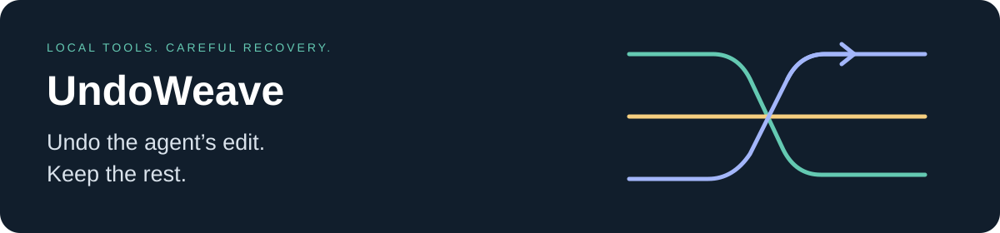

<p align="center"></p>

<h1 align="center">UndoWeave</h1>
<p align="center"><strong>Undo a recorded agent edit. Keep the separate work that came after it.</strong></p>
<p align="center">A local CLI and MCP for careful recovery from coding-agent edits.</p>
<p align="center"><a href="#try-it">Try it</a> · <a href="docs/INSTALL.md">Connect your agent</a> · <a href="docs/AGENT_INSTRUCTIONS.md">Agent instructions</a> · <a href="docs/COMPARISON.md">Measured comparisons</a></p>
<p align="center"><a href="https://github.com/Jgolding1998/undoweave/actions/workflows/checks.yml"></a></p>

Agent A changes one line. You change another. Agent B changes a third. UndoWeave can reverse A's recorded edit while keeping your and B's separate changes. Overlapping or ambiguous edits produce a conflict, with no project file changed.

**Early release:** edits must go through UndoWeave's tools. It does not intercept your agent's shell or built-in editor, identify the author of outside changes, or replace Git backups. Actor names are caller-supplied labels.

## Try it

Python 3.11+ and Git are required for this install command. No AI subscription, API key, or paid service is needed for the demo.

```sh
python -m pip install "undoweave[mcp] @ git+https://github.com/Jgolding1998/undoweave.git@v0.1.0"
undoweave demo
```

The demo uses a disposable directory. It checks selective undo, preservation of a human edit and another agent's edit, conflicts, and stale previews. It does not edit your project or call a model. If your system requires an isolated Python environment, see the [installation guide](docs/INSTALL.md).

From a source checkout:

```sh
python -m venv .venv
# Activate .venv, then:
python -m pip install ".[mcp]"
python -m undoweave demo
```

There is no PyPI release yet. Use the versioned Git install above or install this checkout. The name was checked against GitHub repository search, PyPI and npm before creation; those checks do not establish global name exclusivity.

## Use it with an agent

```sh
undoweave --root /absolute/path/to/your/project config
```

The command prints configuration only. It does not change client settings. Use `config --client claude` for Claude Code instructions or `config --client codex` for Codex commands and TOML. Restart or reconnect the client, then ask it to read the `safe_editing` prompt or `undoweave://instructions` resource.

Give the agent these instructions:

> Use UndoWeave's read_file and write_file tools for edits I want recorded. Use a fixed actor name. Read first and pass the returned expected hash. To undo an edit, show me preview_undo's diff and get my approval before apply_undo. If it conflicts, stop and explain. Do not bypass a refusal with another editor.

The root is fixed at startup. Tools cannot choose another project or run commands. See [full agent instructions](docs/AGENT_INSTRUCTIONS.md) and [Claude Code setup](docs/INSTALL.md).

| Tool | Purpose |
| --- | --- |
| `read_file` | Read selected UTF-8 text and its expected hash |
| `write_file` | Record one whole-file replacement, creation, or explicit deletion |
| `list_changes` | List source-free operation summaries |
| `preview_undo` | Review an inverse and obtain a short-lived token |
| `apply_undo` | Apply that reviewed inverse if the file and recorded history are still current |
| `workspace_status` | Show configuration, limits, and journal counts |

## What happens when changes overlap?

UndoWeave refuses. It does not insert conflict markers, guess which copy of repeated text you intended, or offer a force switch. A refusal can also mean the change exceeds its review or complexity limits. A fresh preview is required if the selected file changes after review.

Each successful undo is recorded as another edit. Previewing and undoing that inverse provides redo. Recovery is one file at a time; this release has no atomic multi-file transaction or automatic undo-all-by-agent.
It tracks text content, not complete filesystem metadata. Recreated files need their permissions reviewed; custom ACLs and extended attributes are not restored.

## Privacy and safety

- No server port, telemetry, shell execution, model calls, or automatic upload. The MCP transport is stdio.
- The local journal stores **plaintext before/after source** outside the project by default. It is not encrypted. Keep it private, include it in your retention policy, and never upload it as a bug report.
- `read_file` and preview diffs disclose selected source to your MCP client. Your client's normal data handling applies.
- Credential-like paths, Git metadata, binary files, symlinks, reparse points and hardlinks are refused. These are guardrails, not a complete secret detector or an OS sandbox.
- File hashes, expiring one-use previews, bounded comparisons, a process lock and a durable intent journal reduce accidental overwrite risk. Outside editors are not locked; a residual validation-to-write race remains.
- Maximum 1 MiB and 4000 lines per file, 16000 characters per preview diff, five-minute preview lifetime, and 128 MiB journal. Repeated text can hit a stricter comparison budget. It never scans the whole workspace to record one edit.

Read the [threat model and recovery notes](SECURITY.md) before using it on important work.

## Verify it

```sh
python -m pip install -c constraints.txt ".[mcp,dev]"
python -m unittest discover -s tests -v
python -m undoweave demo
```

Tests include real MCP subprocess calls, randomized merge cases, crash recovery, concurrent cooperating writers, path escapes, stale previews and local journal corruption. Synthetic tests and comparison fixtures are development evidence, not a guarantee against data loss on every project. See the [validation record](docs/VALIDATION.md) and [comparisons](docs/COMPARISON.md) for the precise checks, pinned upstream versions and limitations.

## Help test a real workflow

Start in a disposable copy of a project. Try two agents and your own editor, preview an undo, and check every resulting diff. Tell us where the tool refused a change you expected to work, or where setup was confusing. Share a small synthetic reproduction, never private source or journal files.

[Contributing](CONTRIBUTING.md) · [Research and inspiration](docs/RESEARCH.md) · [MIT license](LICENSE)
